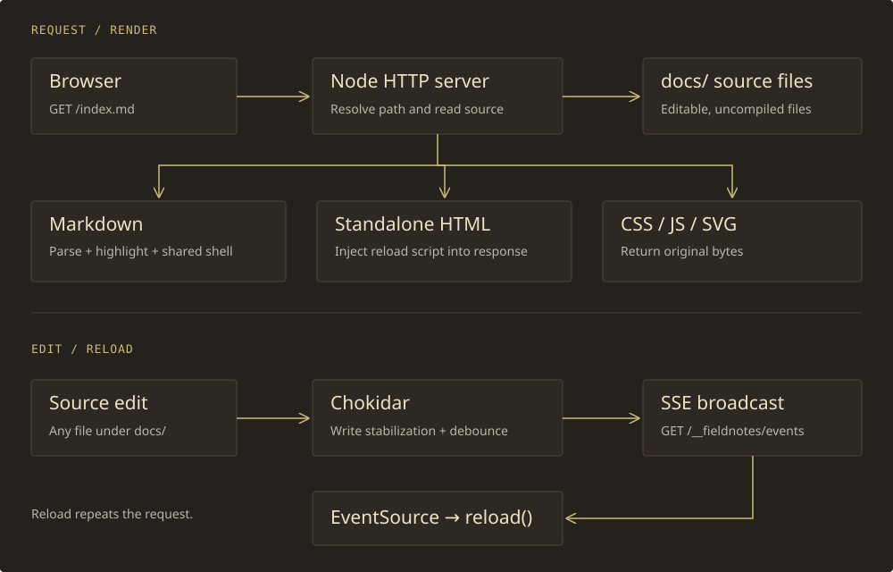

# Rendering and reload pipeline

The viewer has two related paths: an HTTP request turns a source file into a response, and a filesystem event tells connected browsers to request their pages again. Both paths use the same HTTP listener.



## Request routing

| Request | Behavior |
| --- | --- |
| `/` | Redirect to `/index.md` with HTTP 302 |
| `/__fieldnotes/events` | Open an SSE stream for reload notifications |
| `/__fieldnotes/assets/…` | Serve installed viewer assets independently of the project's content |
| `/__fieldnotes/compare?path=…` | Open the read-only comparison UI |
| `/__fieldnotes/api/compare?path=…` | Return current source, HEAD source, rendered previews, and a unified diff |
| `/__fieldnotes/head/…` | Read a content-root-relative asset from HEAD for the baseline preview |
| `/__fieldnotes/context` | Return local project/content paths for a copied review prompt |
| A directory, such as `/spec/` | Read that directory’s `index.md` |
| A `.md` file | Render Markdown and wrap it in the shared document shell |
| A `.html` file | Read HTML and inject the reload script |
| Other files | Return source bytes with an extension-based content type |

The handler decodes the URL pathname, resolves it beneath `docs/`, checks containment, resolves directory indexes, checks the real path, and reads the file. Query strings do not select a different source file. Explicit types cover Markdown/HTML, CSS, JavaScript, SVG, PNG, and JPEG; unlisted extensions use `application/octet-stream`.

Use explicit relative file links such as `[Specification](spec/index.md)`. Directory index lookup exists, but the server does not canonicalize slashless directory URLs; explicit file paths avoid ambiguous browser-relative asset resolution.

## Markdown rendering

1. Read the source file as text.
2. Render it using Markdown-it, including the syntax-highlighting callback.
3. Extract the first rendered plain `<h1>` as the browser title, strip nested tags, and escape it. Use the configured site title when no match is found.
4. Insert the rendered content into the shared `.prose` region.
5. Add configured navigation, the TOC container, built-in and project CSS/scripts, page review tools, and reload support.
6. Send the completed HTML response without writing it to disk.

Trusted inline HTML passes through the renderer. A callout, for example, is authored directly in Markdown:

```html
<aside class="callout">
  <strong>Note:</strong> This content is part of the source document.
</aside>
```

There is no frontmatter parser, include mechanism, template expansion within documents, or generated page manifest.

<aside class="callout"><strong>Rendered example:</strong> This callout is inline HTML in the Markdown source. Its appearance comes from the shared stylesheet.</aside>

## Browser enhancement

After parsing the Markdown response, `document.js` examines `h1`, `h2`, and `h3` elements inside `.prose`.

- Heading text is lowercased; runs of non-letter/non-number characters become hyphens.
- Empty slugs become `section`. Duplicate slugs receive suffixes beginning with `-2`.
- All three heading levels receive IDs. Only `h2` and `h3` enter the TOC.
- An `IntersectionObserver` updates the active TOC link as headings enter its observation region.
- The header link matching the current pathname receives `aria-current="page"`.
- An incoming URL fragment is scrolled into view after IDs are assigned.

Headings below level three still render, but they are not indexed. Heading IDs and the TOC require JavaScript; the prose itself is server-rendered. Renaming a heading changes its fragment identifier.

## Standalone HTML and assets

HTML files are served without the Markdown wrapper. The server inserts page metadata plus the review and reload assets before the closing `head` tag; if that tag is absent, the markup is prepended. The file on disk is unchanged.

CSS, JavaScript, and images are served directly. HTML examples use relative assets so opening the source through `file://` still loads their styles and scripts. A direct-file page receives no server injection and therefore has no live-reload connection.

## Change propagation

1. Chokidar observes additions, edits, and removals under the configured content root and watches the selected JSON configuration file.
2. Write stabilization waits for 150 ms of stability, polling at 50 ms intervals.
3. The server debounces observed events for another 80 ms.
4. It broadcasts an SSE message to every connected reload client:

```text
data: reload

```

5. `reload.js` receives the message through `EventSource('/__fieldnotes/events')` and calls `location.reload()`.
6. The browser requests the current document and its assets again.

The timings reduce partial-write and multi-event refreshes; they are not a guaranteed end-to-end latency. Events are global, not filtered by the page’s dependencies. Editing a CSS or SVG file reloads Markdown pages and HTML examples alike.

## Connection and restart behavior

The stream begins with a connection comment and receives heartbeat comments every 20 seconds. Disconnected responses are removed from the client set. Native `EventSource` reconnects after connection failures, but the server does not retain event history or replay changes missed while disconnected.

The content root and selected site configuration are watched. Changes to server modules, dependency configuration, or the Nix environment require the relevant restart or setup command. Packaged built-in assets are immutable; update the flake input to upgrade them. Refresh the browser after a server restart if a missed change is not displayed.

## Reload state

Reload is full-page navigation, not DOM patching or hot module replacement. In-memory JavaScript state, selections, and unsaved form text are discarded. Stored data, such as the task examples’ `localStorage` snapshot, can be read again after reload.

This behavior keeps the rendering path identical for initial loads and edits. It also avoids a second client-side Markdown renderer or an asset dependency graph.
